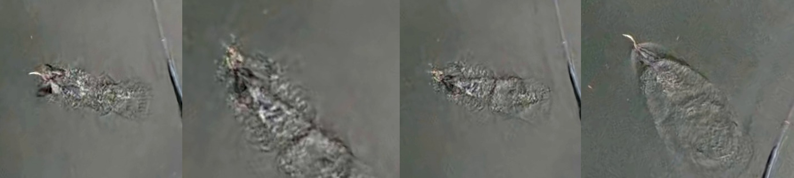
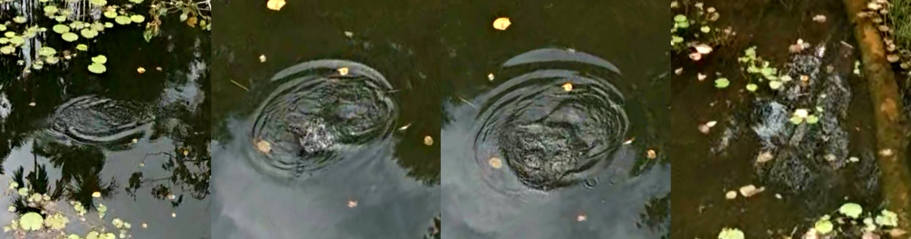
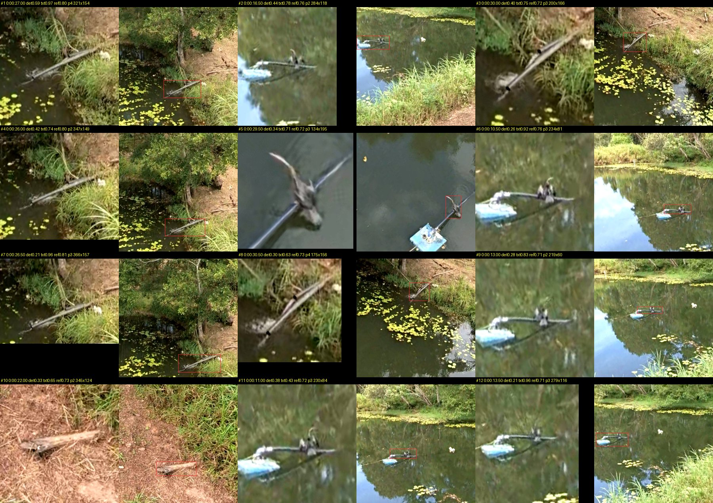

# dji-estate-croc

Searches DJI Avata 360 footage for crocodiles.

The Avata 360 records `.OSV` files holding two 3840x3840 fisheye video streams: one lens
looks up, one looks down. Only the downward lens (video stream 1) sees the ground and water,
so that is the one scanned.

## How it works

1. **Decode** the downward lens at about 5 frames per second (`crocfinder/ingest.py`).
2. **Reproject** each fisheye frame into flat, overlapping perspective tiles at native pixel
   density, so small animals are not shrunk (`crocfinder/geometry.py`).
3. **Detect** with a zero-shot, text-prompted detector (OWLv2 or Grounding DINO) at a low
   threshold. No training data is needed (`crocfinder/detect.py`).
4. **Verify** each candidate crop with an image-text model, compare it to reference croc
   photos, and check that it shows up in neighbouring frames (`crocfinder/verify.py`).
5. **Dense pass**: every frame is scanned for a few seconds around surviving candidates.
6. **Report**: a ranked HTML gallery and a CSV with timecodes (`crocfinder/report.py`).

A person makes the final call by looking at the top of the gallery.

## Usage

```bash
pip install -r requirements.txt        # also needs ffmpeg on PATH
python -m crocfinder.run probe VIDEO.OSV
python -m crocfinder.run tiles VIDEO.OSV --t 20 --out out/tiles     # check the reprojection by eye
python -m crocfinder.run scan  VIDEO.OSV --out out/VIDEO --refs refs/
pytest
```

Videos, frames and full results are never committed; a small set of review images lives in
`docs/images/`. The use case and the findings of the first run are in [docs/USECASE.md](docs/USECASE.md). Bucket and project names live in an
untracked `.env` (see `.env.example`).

## First run: what it found (26 November 2026)

Seven flights (`0097` to `0103`) were scanned. No crocodile was confirmed. Three moments could
not be ruled out from the crops and need a person to watch the original footage.

### Video 0097, 1:10 to 1:13



Frames at 1:10.2, 1:10.4, 1:10.4 and 1:11.0. Something moves across open water and leaves a
widening wake, with a small pale curved tip at its head. The dark diagonal line is a rope with
white floats. It looks small and splashy for a crocodile; a bird or a hooked fish are as likely.

### Video 0100, 0:04, 0:17 and 0:33



- **First three frames (0:04, 0:17, 0:17.5):** concentric ripples with a rough textured patch in
  the centre, at the same bearing each time and off to the side of the drone, so not simply
  propeller wash. Could be something that just submerged, a fish, or a bubbler.
- **Last frame (0:33):** a dark textured shape in the shallows beside a log, under floating
  leaves. Probably debris, but the most crocodile-shaped thing in the set.

### Typical false alarms



Top 12 candidates for video 0103, each crop next to its wider view with the detection boxed in
red. The yellow line gives rank, timecode and scores. These are all false alarms: a pipe running
into the water, cormorants on the pump float, and a log on the bank. The other contact sheets
are in [docs/images/](docs/images/).

### How far to trust a clean result

The phone photo of the crocodile was pasted into real frames and the detector asked to find it.
Even at 192 px across it was found in only 28 of 48 tries (base pass) and 20 of 48 (zoom pass),
and almost never below 48 px. A clean gallery is weak evidence that no crocodile is present.
The full table and review notes are in [docs/USECASE.md](docs/USECASE.md).

## Limits

- A fully submerged animal, or one under tree cover, cannot be seen by any model.
- The detector has not been trained on this footage; treat a clean gallery as
  "nothing found by this method", not proof that no crocodile is present.
