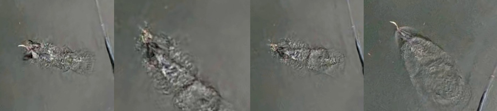
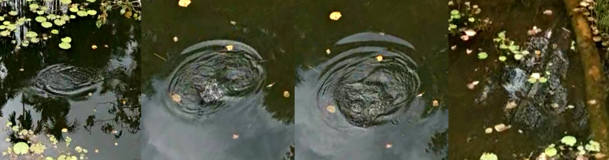

# Use case and first run

## Use case

A crocodile was photographed by phone at a pond on the estate. The aim is to find out whether
it is still there, and where, without walking the banks: fly a DJI Avata 360 over the ponds and
let software pick out the moments worth a person's attention.

The software does not decide. It ranks candidates so that a person can check a few dozen crops
instead of watching every minute of 360° footage.

## First run: 26 November 2026

Seven flights (`0097` to `0103`, about 90 seconds each) were scanned twice on a rented L4 GPU:

| Pass | Tile field of view | Frame rate | Videos done |
|---|---|---|---|
| base | 48° | 5 fps | 7 of 7 |
| zoom2x | 24° | 2 fps | 7 of 7 |

The dense every-frame pass was switched off for this run.

### Result

No confirmed crocodile. Three moments could not be ruled out from the crops and need a person
to watch the original footage:

| Video | Time | What is visible |
|---|---|---|
| 0097 | 1:10 – 1:13 | Something moving across open water, leaving a widening wake, with a small pale curved tip at its head. Beside a line with white floats. Looks small and splashy for a crocodile (a bird or a hooked fish are as likely). |
| 0100 | 0:04 and 0:16 – 0:18 | Concentric ripples with a rough textured patch in the centre, at the same bearing both times and off to the side of the drone. Could be something that just submerged, a fish, or a bubbler. |
| 0100 | 0:33 | Dark textured shape in the shallows beside a log, under floating leaves. Probably debris, but the most crocodile-shaped thing in the set. |

Video 0097, 1:10.2 / 1:10.4 / 1:10.4 / 1:11.0:

Video 0100, 0:04 / 0:17 / 0:17.5 / 0:33:

Most other top-ranked hits were a pipe running into the water, a log on the bank, and
cormorants on the pump float.

### How much was reviewed

The top 12 candidates per video were looked at for the base pass of 0097 – 0101 and the zoom
pass of 0097, 0100 and 0103. The contact sheets in `images/` (`base_*.jpg`, `zoom2x_*.jpg`)
show each crop next to its wider context. Not yet looked at: base 0102 and 0103 (no sheet
made), and the zoom sheets for 0098, 0099, 0101 and 0102.

### Recall check

The phone photo of the crocodile was pasted into real frames at several sizes, 48 times per
size, and the detector was asked to find it (`crocfinder/synth.py`; raw numbers in
`recall_base.json` and `recall_zoom2x.json`).

| Crocodile size in tile | base found | zoom2x found |
|---|---|---|
| 24 px | 0 of 48 | 0 of 48 |
| 32 px | 0 of 48 | 1 of 48 |
| 48 px | 3 of 48 | 9 of 48 |
| 64 px | 7 of 48 | 14 of 48 |
| 96 px | 13 of 48 | 8 of 48 |
| 128 px | 12 of 48 | 14 of 48 |
| 192 px | 28 of 48 | 20 of 48 |

Even a large, clearly visible crocodile is found only about half the time in a single frame.
A clean gallery from this run is weak evidence that no crocodile is present.

## What was kept

After the run the rented GPU machine and the cloud copies of the videos, crops and galleries
were deleted. Kept in this repository:

- `run_20261126/<pass>/<video>/candidates.csv` and `meta.json`: every ranked candidate with its
  timecode, viewing direction and scores, for all 14 runs. The crop images they name are gone.
- `images/`: the two close-ups and 12 contact sheets.
- `recall_base.json`, `recall_zoom2x.json`: the recall check.

Re-running needs the original `.OSV` files uploaded again and a GPU machine; see
`scripts/queue.sh`.

## Open work

- Watch the three moments above in the original footage.
- The galleries not yet reviewed were deleted with the cloud copy; reviewing them means re-running those videos.
- Raise recall: try a stronger detector, and turn the dense pass back on.
